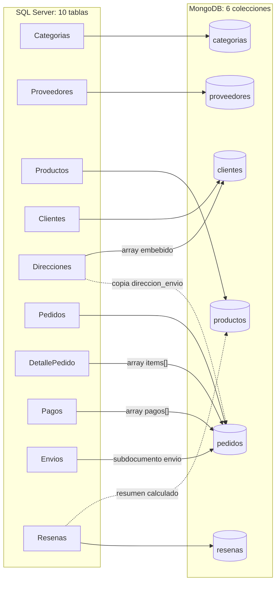
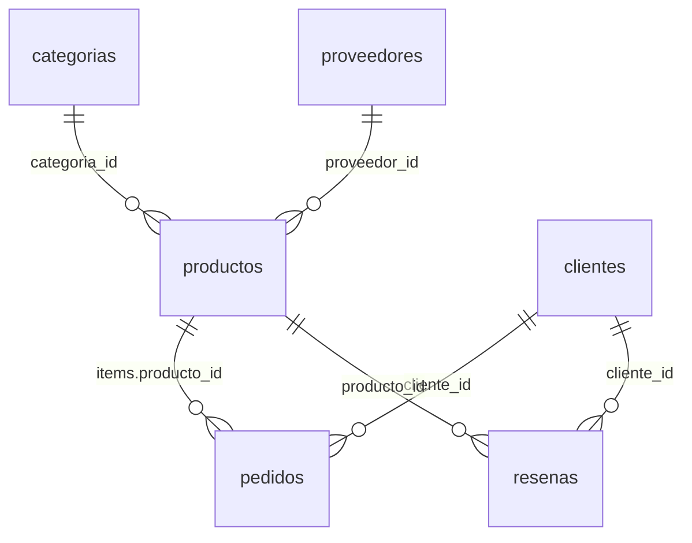

# Modelo documental — tienda_online (MongoDB)

## De 10 tablas a 6 colecciones



| Colección | Documentos | Proviene de | Técnica |
|---|---:|---|---|
| `categorias` | 12 | Categorias | Colección independiente |
| `proveedores` | 25 | Proveedores | Colección independiente; contacto y ubicación agrupados en subdocumentos |
| `productos` | 300 | Productos (+ Resenas) | **Referencing** a categoría y proveedor; resumen de calificación **calculado** |
| `clientes` | 800 | Clientes + Direcciones | **Embedding**: `direcciones[]` (array de documentos) |
| `pedidos` | 2.000 | Pedidos + DetallePedido + Pagos + Envios (+ Direcciones) | **Embedding**: `items[]`, `pagos[]`, `envio`, `direccion_envio`, `totales`; **Referencing** a cliente y productos |
| `resenas` | 1.378 | Resenas | **Referencing** a producto y cliente |

Diagrama de relaciones entre colecciones (las flechas son referencias resueltas con `$lookup`):



## Estructura de cada colección

### `pedidos` (une 4 tablas en un documento)

```js
{
  _id: 24,                                  // = PedidoID
  cliente_id: 658,                          // REFERENCIA -> clientes._id
  fecha: ISODate("2025-01-15T23:56:54Z"),
  estado: "Entregado",
  direccion_envio: {                        // COPIA de la dirección al momento de comprar
    direccion_id: 985, linea: "Diagonal 55 # 46-71 Apto 564",
    ciudad: "Medellín", departamento: "Antioquia", codigo_postal: "050071"
  },
  items: [                                  // EMBEBIDO: antes la tabla DetallePedido
    { producto_id: 69,                      // REFERENCIA -> productos._id
      sku: "COC-00069", nombre: "Sartén antiadherente Kora Pro",   // copia para mostrar sin $lookup
      cantidad: 1, precio_unitario: Decimal128("174900.00"),
      descuento_pct: Decimal128("0.00"), subtotal: Decimal128("174900.00") },
    ...
  ],
  totales: { subtotal: Decimal128("585220.00"), costo_envio: Decimal128("0.00"), total: Decimal128("585220.00") },
  pagos: [                                  // EMBEBIDO: antes la tabla Pagos (1:N)
    { pago_id: 25, metodo: "Tarjeta credito", estado: "Rechazado", monto: ..., fecha: ..., referencia: "PAY-0000025" },
    { pago_id: 26, metodo: "Tarjeta credito", estado: "Aprobado",  monto: ..., fecha: ..., referencia: "PAY-0000026" }
  ],
  envio: {                                  // EMBEBIDO: antes la tabla Envios (1:0..1); ausente si no se ha despachado
    envio_id: 23, transportadora: "Servientrega", numero_guia: "SVT002408767",
    fecha_despacho: ..., fecha_entrega_estimada: ..., fecha_entrega: ..., estado: "Entregado"
  }
}
```

### `clientes`

```js
{
  _id: 1, nombres: "Daniela", apellidos: "...", email: "...", telefono: "...",
  fecha_nacimiento: ISODate(...), fecha_registro: ISODate(...), segmento: "Plata",
  direcciones: [                            // EMBEBIDO: antes la tabla Direcciones
    { direccion_id: 1, alias: "Casa", linea: "...", ciudad: "Bogotá",
      departamento: "Cundinamarca", codigo_postal: "110123", es_principal: true },
    ...
  ]
}
```

### `productos`

```js
{
  _id: 14, sku: "TEC-00014", nombre: "Smartwatch Zenit Plus", descripcion: "...",
  precio: Decimal128("..."), costo: Decimal128("..."), stock: 9, activo: true,
  fecha_creacion: ISODate(...),
  categoria_id: 1,                          // REFERENCIA -> categorias._id
  proveedor_id: 7,                          // REFERENCIA -> proveedores._id
  calificacion: { promedio: 4.12, total_resenas: 17 }   // CALCULADO a partir de Resenas
}
```

### `resenas`, `proveedores`, `categorias`

```js
// resenas
{ _id: 1, producto_id: 52, cliente_id: 310, calificacion: 4, comentario: "...", fecha: ISODate(...) }
// proveedores
{ _id: 1, razon_social: "...", nit: "...", contacto: { email, telefono }, ubicacion: { ciudad, pais } }
// categorias
{ _id: 1, nombre: "Tecnología", descripcion: "..." }
```

Los documentos reales completos están en [`evidencias/ejemplos/`](../evidencias/ejemplos).

## Decisiones de Embedding y Referencing

La regla que usamos: **se embebe lo que pertenece a un solo padre, tiene un tamaño acotado y casi siempre se lee junto con el padre. Se referencia lo que tiene vida propia, lo usan varias partes del sistema o puede crecer sin límite.**

| Relación en SQL | Decisión | Por qué |
|---|---|---|
| Pedidos → **DetallePedido** | **Embedding** (`items[]`) | Una línea no existe sin su pedido y nunca se consulta sola. Un pedido tiene pocas líneas (1 a 5), así que el array está acotado. Leer, crear o cancelar un pedido toca un solo documento, y la escritura es **atómica** sin necesidad de una transacción entre tablas. |
| Pedidos → **Pagos** | **Embedding** (`pagos[]`) | Los intentos de pago pertenecen solo a ese pedido y son pocos (normalmente 1, con un rechazo previo como máximo 2). Para saber si un pedido está pagado hay que verlos junto al pedido. |
| Pedidos → **Envios** | **Embedding** (subdocumento `envio`) | Es una relación 1:0..1. Si el pedido no se ha despachado, el campo no existe. Tener una colección aparte para un único documento por pedido solo añadiría `$lookup`. |
| Pedidos → **Direcciones** | **Copia** (`direccion_envio`) | Aquí no conviene una referencia. Si el cliente cambia o borra la dirección después, el pedido debe seguir mostrando **a dónde se envió realmente**. Es un dato histórico, igual que una factura. Se conserva `direccion_id` para trazabilidad. |
| Clientes → **Direcciones** | **Embedding** (`direcciones[]`) | El cliente tiene de 1 a 3 direcciones que solo le pertenecen a él y siempre se muestran en su perfil y en el checkout. |
| Pedidos → **Clientes** | **Referencing** (`cliente_id`) | El cliente tiene vida propia y acumula pedidos sin límite. Embeber los pedidos en el cliente haría crecer el documento sin control (el límite es de 16 MB). Embeber el cliente en cada pedido duplicaría sus datos 2.000 veces y obligaría a actualizarlos en todas partes. |
| items → **Productos** | **Referencing** (`items.producto_id`) más una **copia** de `sku` y `nombre` | El producto es una entidad independiente que usan el catálogo, el inventario, los pedidos y las reseñas, y su stock y precio cambian. El precio de la línea se guarda (`precio_unitario`) porque es el precio **al que se vendió**. La copia de `nombre` y `sku` sirve para mostrar el pedido sin hacer `$lookup` (patrón *extended reference*). |
| Productos → **Categorias** y **Proveedores** | **Referencing** | Son catálogos compartidos por muchos productos. Si cambia el email de un proveedor, se actualiza un solo documento. |
| **Resenas** | **Colección propia** con referencias a producto y cliente | Las reseñas crecen sin límite (un producto popular puede tener miles), se consultan desde el producto y desde el cliente, y se analizan por separado (consulta C5). Embeberlas en el producto lo haría crecer sin control. |
| Productos ← Resenas | **Campo calculado** `calificacion {promedio, total_resenas}` | La ficha del producto muestra su promedio en cada visita. Precalcularlo evita agregar todas las reseñas en cada lectura (patrón *computed*). |

### Ventajas para este caso

- **La pantalla "Mi pedido" se resuelve con una sola lectura** (`find({_id})`): ítems, pagos, envío y dirección vienen juntos. En SQL hacen falta 5 JOINs.
- **Atomicidad**: crear un pedido con sus líneas y su primer pago es un solo `insertOne`.
- **Sin duplicación de entidades que cambian**: cliente, producto, proveedor y categoría existen una sola vez y se combinan con `$lookup` cuando hace falta.
- **Historial fiel**: el precio y la dirección del pedido quedan congelados.

### Costo que asumimos

- La copia de `nombre` en `items` puede quedar desactualizada si el producto se renombra. Es aceptable, porque refleja cómo se llamaba al venderse.
- `calificacion` debe recalcularse cuando llega una reseña nueva (en la migración se calcula y la verificación comprueba que coincide).

## Otras decisiones técnicas

- **`_id` = llave primaria de SQL Server.** Mantiene la trazabilidad (el pedido 24 es el mismo en ambos motores), facilita la verificación y hace que las referencias sean simples enteros.
- **Dinero como `Decimal128`.** Conserva la precisión exacta de `DECIMAL(14,2)`. Con `double` aparecerían errores de redondeo en las sumas. Por eso la verificación puede comparar los totales al centavo.
- **Fechas.** `DATE` se convierte a `Date` a medianoche, porque MongoDB no tiene un tipo solo-fecha.
- **Sin `NULL`.** Un campo que no aplica no se guarda. Por ejemplo, un pedido sin despachar no tiene `envio`, y uno en tránsito no tiene `envio.fecha_entrega`.
- **Validación `$jsonSchema`** en `pedidos` y `clientes` (campos obligatorios, estados válidos, `items` con al menos una línea, etc.).
- **Índices** sobre las referencias y los campos de filtro: `pedidos.cliente_id+fecha`, `pedidos.items.producto_id`, `pedidos.fecha`, `pedidos.estado`, `pedidos.envio.transportadora`, `productos.categoria_id`, `productos.proveedor_id`, `productos.stock`, `resenas.producto_id+cliente_id` (único) y los únicos `sku` y `email`.

## Proceso de migración (`migracion/migrar.py`)

1. **Extraer**: lee las 10 tablas con `pyodbc`. El detalle se lee con un `JOIN` a Productos para obtener `sku` y `nombre`.
2. **Transformar**: agrupa las tablas hijas por su llave foránea (`defaultdict`) y construye los documentos:
   - `Direcciones` agrupadas por `ClienteID` → `clientes.direcciones[]`.
   - `DetallePedido`, `Pagos` y `Envios` agrupados por `PedidoID` → `items[]`, `pagos[]` y `envio` de cada pedido.
   - La dirección del pedido se busca por `DireccionID` y se copia en `direccion_envio`.
   - `Resenas` agrupadas por `ProductoID` → promedio y total en `productos.calificacion`.
3. **Cargar**: borra y recrea cada colección (la migración se puede repetir), aplica los validadores, inserta en lotes de 1.000 y crea los índices.

## Cómo se verificó que la información se conserva (`migracion/verificar.py`)

Resultado: **79/79 controles correctos** ([evidencias/03_verificacion_migracion.md](../evidencias/03_verificacion_migracion.md)).

1. **Conteos**: cada tabla contra su colección. Las tablas que se fusionaron se cuentan sumando el tamaño de los arrays. Por ejemplo, filas de `DetallePedido` (4.317) = `Σ $size(items)` (4.317), y filas de `Envios` = pedidos con el campo `envio`.
2. **Sumas de control**: Σ total de pedidos, Σ subtotales de líneas, Σ cantidades, Σ pagos aprobados, Σ stock y Σ calificaciones. Deben coincidir **exactamente**, gracias a `Decimal128`.
3. **Integridad referencial**: cada referencia se resuelve con `$lookup` y se cuentan los huérfanos (deben ser 0).
4. **Estructuras embebidas**: `Σ items.subtotal = totales.subtotal`, `total = subtotal + envío`, la dirección de envío pertenece al cliente, cada cliente tiene exactamente una dirección principal, todo pedido Entregado tiene fecha de entrega, el resumen de calificación coincide con las reseñas y todos los documentos cumplen el `$jsonSchema`.
5. **Muestra campo a campo**: 5 pedidos al azar se comparan con SQL Server (cliente, estado, fecha, total, ciudad, número de líneas y de pagos, guía, y cada línea completa).
