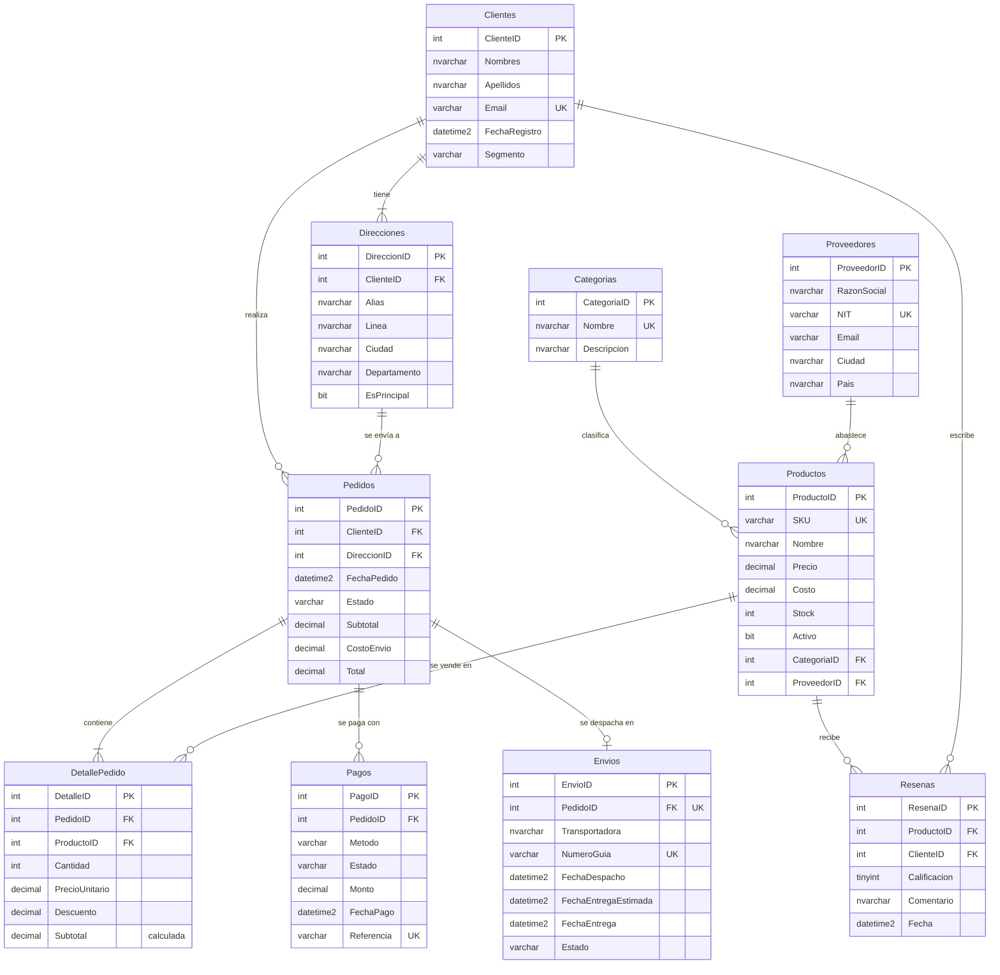

# Modelo relacional — TiendaOnline (SQL Server)

**Caso de estudio:** una tienda en línea colombiana que vende productos de 12 categorías a clientes en 12 ciudades. Despacha con 6 transportadoras y recibe pagos por 5 medios.

## Diagrama entidad–relación

## Entidades y volumen

| # | Tabla | Registros | Rol en el negocio | Relaciones |
|---|---|---:|---|---|
| 1 | Categorias | 12 | Clasificación del catálogo | 1:N con Productos |
| 2 | Proveedores | 25 | Empresas que abastecen productos | 1:N con Productos |
| 3 | Productos | 300 | Catálogo con precio, costo y stock | N:1 Categoría, N:1 Proveedor |
| 4 | Clientes | 800 | Compradores registrados, segmentados (Estándar/Plata/Oro) | 1:N Direcciones, Pedidos, Reseñas |
| 5 | Direcciones | 1.185 | Libreta de direcciones del cliente (1 a 3) | N:1 Cliente |
| 6 | Pedidos | 2.000 | Encabezado de la compra y su estado | N:1 Cliente, N:1 Dirección |
| 7 | DetallePedido | 4.317 | Líneas del pedido (resuelve la relación N:M Pedido–Producto) | N:1 Pedido, N:1 Producto |
| 8 | Pagos | 2.144 | Intentos de pago (aprobados, rechazados o reembolsados) | N:1 Pedido |
| 9 | Envios | 1.866 | Despacho con transportadora y fechas | 1:0..1 con Pedido |
| 10 | Resenas | 1.378 | Calificación de 1 a 5 de un producto recibido | N:1 Producto, N:1 Cliente |
| | **Total** | **14.027** | | |

El volumen sigue la lógica del negocio. Las tablas maestras son pequeñas (categorías y proveedores). Las transaccionales son grandes (pedidos, sus líneas y sus pagos).

## Reglas de integridad implementadas

- **Llaves primarias y foráneas** en las 11 relaciones, con índices en cada FK.
- **CHECK**: precio y costo positivos, stock ≥ 0, estados y métodos de pago dentro de un dominio cerrado, calificación entre 1 y 5, descuento entre 0 y 100, y `Total = Subtotal + CostoEnvio`.
- **UNIQUE**: SKU, email del cliente, NIT, referencia de pago y número de guía. También `(PedidoID, ProductoID)` en el detalle (un producto aparece una sola vez por pedido) y `(ProductoID, ClienteID)` en reseñas (una reseña por cliente y producto). `Envios.PedidoID` es único, así que un pedido tiene como máximo un envío.
- **Columna calculada persistida** `DetallePedido.Subtotal = Cantidad × PrecioUnitario × (100 − Descuento) / 100`.

## Coherencia de los datos generados

`sql/generar_datos.py` genera los datos con una semilla fija y respeta estas reglas (se comprueban en `sql/03_verificacion_sql.sql`):

- El pedido siempre se envía a una dirección **de su propio cliente**.
- El subtotal del pedido es la suma de sus líneas. El envío es gratis desde $150.000 y cuesta $9.900 por debajo de ese valor.
- El estado del pedido corresponde a sus pagos y a su envío. *Pendiente* no tiene pago aprobado. *Pagado* no tiene envío. *Enviado* está en tránsito. *Entregado* tiene fecha de entrega. *Cancelado* no tiene envío.
- Contraentrega solo aparece en pedidos entregados, porque el cliente paga al recibir.
- Solo reseñan los clientes que **recibieron** el producto, y la reseña es posterior a la entrega.
- Cada transportadora tiene un tiempo de entrega distinto, cada medio de pago una tasa de rechazo distinta y cada producto una "calidad" que influye en sus calificaciones. Por eso las consultas encuentran diferencias reales que analizar.
